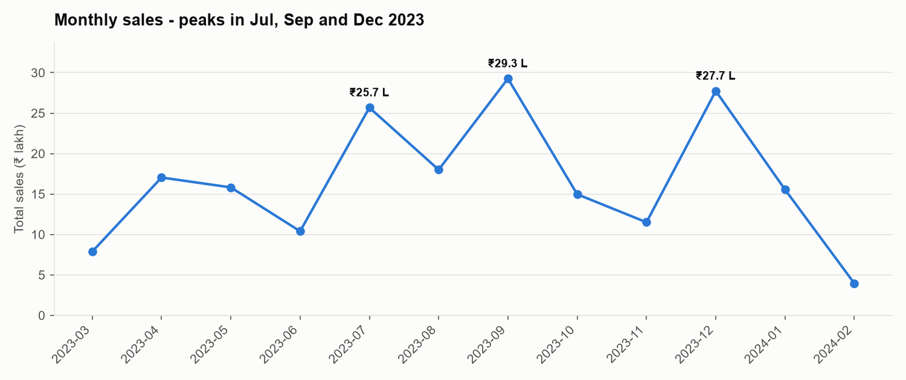
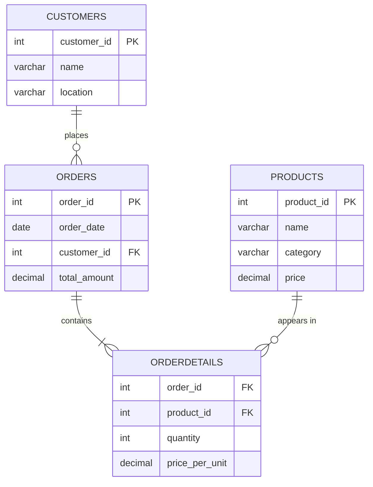
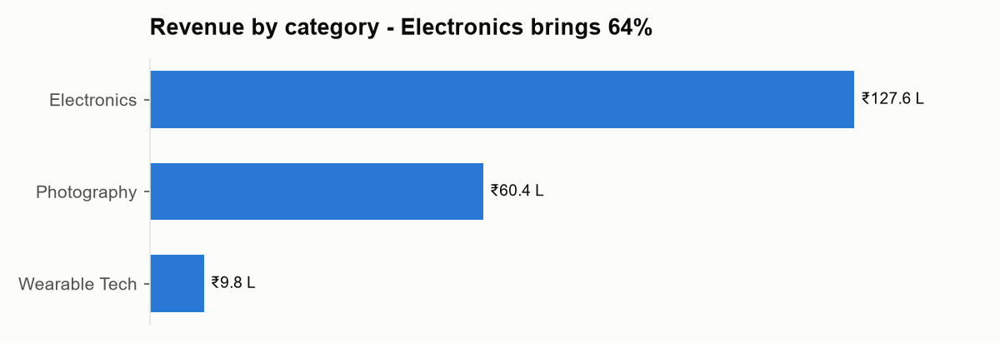
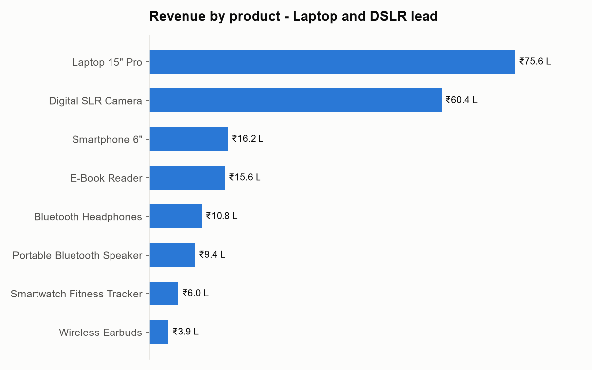
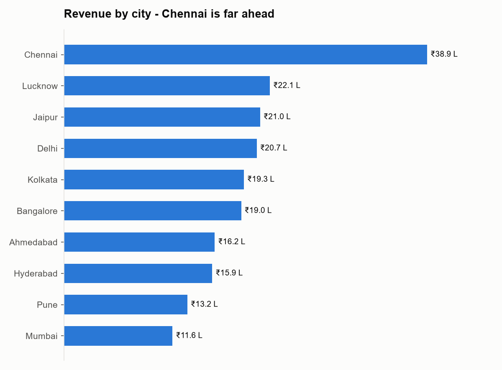
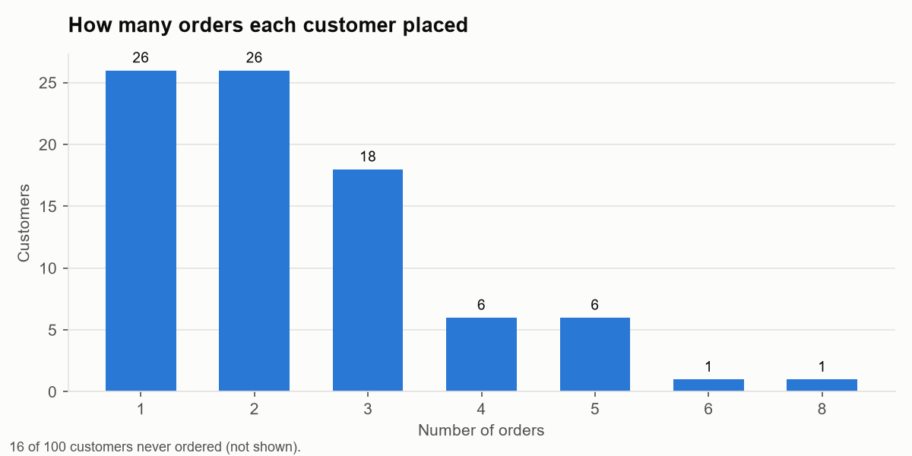
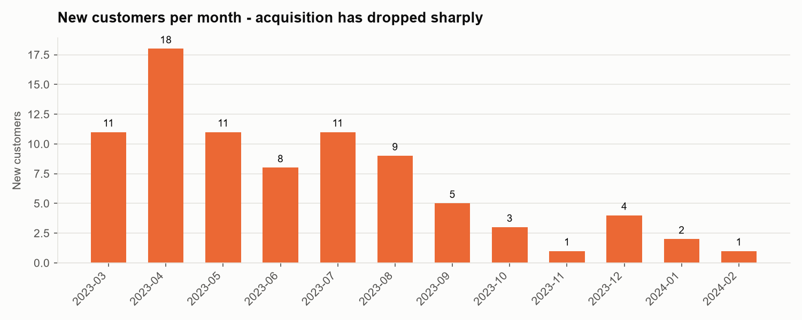
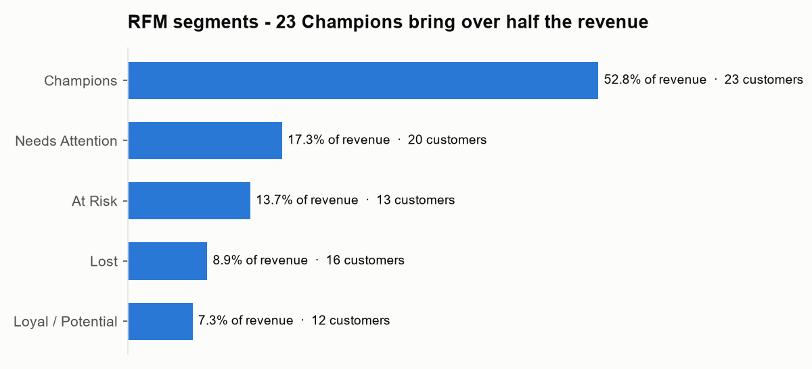
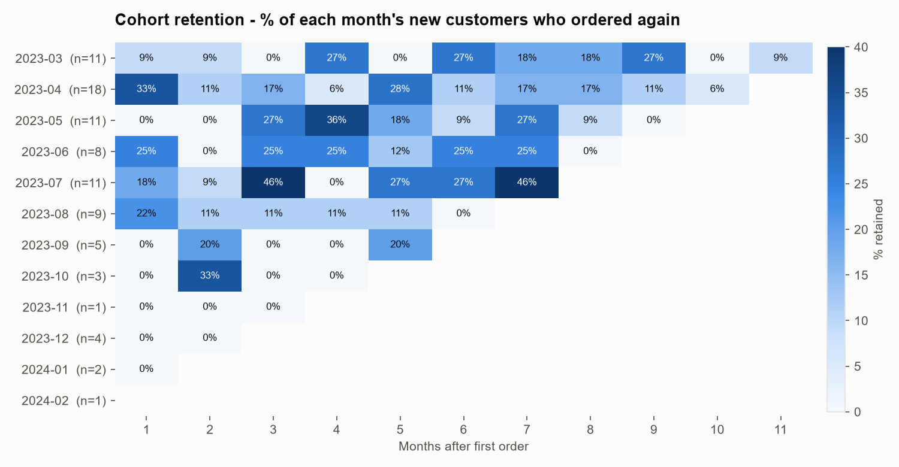

# 🛒 E-Commerce Sales Analysis — SQL · Excel · Python

End-to-end data analysis of an Indian e-commerce company's customers, products and orders
(Mar 2023 – Feb 2024). The goal is to give the **marketing, sales and supply-chain teams**
actionable insights on customers, products, sales trends and inventory.

| | |
|---|---|
| **SQL (MySQL 8.0)** | database design, 20 business queries, views, stored procedures, window functions, RFM segmentation, cohort retention |
| **Excel** | MIS dashboard with KPI tiles, SUMIFS/COUNTIFS/INDEX-MATCH formulas and charts |
| **Python** | pandas notebook repeating the analysis + matplotlib charts |



---

## 📂 Project Structure

```
ecommerce-sql-case-study/
├── data/
│   ├── ecommerce_data.xlsx          # original dataset (4 sheets)
│   └── customers.csv  products.csv  orders.csv  orderdetails.csv
├── sql/
│   ├── 01_create_and_load.sql       # creates ecommerce_db + tables, inserts all 927 rows
│   ├── 02_analysis_queries.sql      # 20 business questions (Q0–Q17)
│   └── 03_advanced_sql.sql          # views, stored procedures, RFM, cohort retention
├── results/
│   ├── query_results.md             # output of every query in 02
│   └── advanced_sql_results.txt     # MySQL output of 03
├── dashboard/
│   └── ecommerce_dashboard.xlsx     # Excel MIS dashboard
├── notebooks/
│   └── ecommerce_analysis.ipynb     # pandas version of the analysis
├── images/                          # charts used in this README
├── scripts/                         # Python scripts that build data, results, charts, dashboard, notebook
└── requirements.txt
```

## 🗄️ Dataset & Schema

| Table | Rows | Columns |
|---|---|---|
| **Customers** | 100 | customer_id (PK), name, location |
| **Products** | 8 | product_id (PK), name, category, price |
| **Orders** | 200 | order_id (PK), order_date, customer_id (FK), total_amount |
| **OrderDetails** | 519 | order_id (FK), product_id (FK), quantity, price_per_unit |



**Data quality checks:** no missing values; every foreign key matches; `price_per_unit` always
equals the product price; each order's `total_amount` equals the sum of its lines. OrderDetails has
24 repeated lines that are counted in the order totals, so they are kept (no composite primary key).

## ▶️ How to Run

**MySQL Workbench**
1. Connect to your local MySQL server.
2. **File → Open SQL Script →** `sql/01_create_and_load.sql` → ⚡ **Execute** (creates `ecommerce_db`).
3. Open and execute `sql/02_analysis_queries.sql`, then `sql/03_advanced_sql.sql`.

**Excel dashboard** – open `dashboard/ecommerce_dashboard.xlsx`. The data sheets (Customers, Products,
Orders, OrderDetails) feed every number on the Dashboard sheet through formulas.

**Python**
```bash
pip install -r requirements.txt
python scripts/build_project.py     # Excel -> CSV, MySQL load script, query results
python scripts/make_charts.py       # images/*.png
python scripts/make_dashboard.py    # dashboard/ecommerce_dashboard.xlsx
python scripts/make_notebook.py     # notebooks/ecommerce_analysis.ipynb (executed)
```

## ❓ Business Questions — `sql/02_analysis_queries.sql`

| # | Area | Question | SQL concepts |
|---|---|---|---|
| Q1 | Customer | Top 3 cities by number of customers | GROUP BY, ORDER BY, LIMIT |
| Q2 | Customer | Distribution of customers by number of orders (+ segments) | CTE, CASE |
| Q3 | Customer | Customers who never ordered | LEFT JOIN, IS NULL |
| Q4 | Customer | Top 5 customers by spend | JOIN, aggregation |
| Q5 | Customer | Revenue by city | JOIN, COUNT DISTINCT |
| Q6 | Product | Products with avg quantity 2 but high revenue | HAVING |
| Q7 | Product | Unique customers per category | multi-table JOIN |
| Q8 | Product | Revenue share by category | subquery |
| Q9 | Product | Product revenue ranking | RANK() |
| Q10 | Sales | Month-on-month % change in sales | LAG() |
| Q11 | Sales | Average order value change by month | LAG() |
| Q12 | Sales | Top 3 peak sales months | DATE_FORMAT |
| Q13 | Sales | Running total of sales | SUM() OVER |
| Q14 | Sales | New customers per month and growth % | CTE + MIN + LAG |
| Q15 | Inventory | Top 5 products by sales frequency | aggregation |
| Q16 | Inventory | Products bought by < 40 % of customers | HAVING + subquery |
| Q17 | Inventory | Monthly units sold by category | multi-level GROUP BY |

Full output: [results/query_results.md](results/query_results.md)

## 🧠 Advanced SQL — `sql/03_advanced_sql.sql`

| Object | What it does |
|---|---|
| `vw_order_lines` | view: every order line joined with customer and product |
| `vw_customer_summary` | view: orders, spend, AOV, first/last order per customer (incl. non-buyers) |
| `vw_monthly_sales` | view: monthly orders, active customers, sales, AOV |
| `vw_customer_rfm` | view: Recency/Frequency/Monetary scores (NTILE(4)) and segment per customer |
| `sp_customer_report(id)` | procedure: summary + purchase history of one customer |
| `sp_top_products_by_month('YYYY-MM', n)` | procedure: top n products in a month |
| `sp_city_report('City')` | procedure: KPIs and category split for a city |
| Cohort retention query | % of each first-order month's customers who came back N months later |
| Repeat purchase rate | share of buying customers with more than one order |

```sql
CALL sp_customer_report(32);
CALL sp_top_products_by_month('2023-09', 3);
SELECT * FROM vw_customer_rfm ORDER BY monetary DESC;
```

MySQL output: [results/advanced_sql_results.txt](results/advanced_sql_results.txt)

## 📊 Excel Dashboard — `dashboard/ecommerce_dashboard.xlsx`

- **KPI tiles:** Total Revenue ₹1,97,83,000 · 200 Orders · AOV ₹98,915 · 100 Customers · 84 Buyers · 69.0% Repeat Rate
- **Tables + charts:** monthly sales with MoM %, revenue by category / product / city, customer segments, RFM segments
- **Formulas, not pasted numbers:** `SUMIF`, `COUNTIF`, `INDEX/MATCH` and helper columns (month key, location,
  category) on the data sheets – change the data and the dashboard updates.

## 🐍 Python Notebook — `notebooks/ecommerce_analysis.ipynb`

Same questions answered with pandas (`groupby`, `merge`, `pct_change`, `cumsum`, `pd.cut`, cohort pivot),
with the matching SQL idea noted in each section. All results match the MySQL output.

## 💡 Key Insights

<table>
<tr>
<td></td>
<td></td>
</tr>
<tr>
<td></td>
<td></td>
</tr>
<tr>
<td></td>
<td></td>
</tr>
</table>



**Customers**
- **Delhi (16), Chennai (15) and Jaipur (11)** have the most customers – best cities for targeted campaigns.
- **Chennai is the #1 revenue city (₹38.9 L)**, almost double the next city (Lucknow ₹22.1 L).
- **16 of 100 customers never ordered** – a ready list for a first-purchase coupon campaign.
- Of 84 buyers, **50 are occasional (2–4 orders), 26 one-time and 8 regular (5+)**; the **repeat rate is 69%**.
- **RFM: 23 "Champions" bring 52.8% of revenue**, while 13 "At Risk" customers (good buyers who have
  gone quiet) hold 13.7% – a win-back campaign should start with them.

**Products**
- **Electronics brings 64.5% of revenue**, Photography 30.5%, Wearable Tech only 5%.
- **Laptop 15" Pro (₹75.6 L) and Digital SLR Camera (₹60.4 L)** make ~69% of all revenue.
- Smartphone and Wireless Earbuds sell **2 units per order on average** but each reaches fewer than
  40% of customers – good candidates for cross-sell and bundles.

**Sales**
- Total revenue ₹1.98 Cr over 12 months. **Peak months: Sep 2023 (₹29.3 L), Dec 2023 (₹27.7 L), Jul 2023 (₹25.7 L)**.
- Sales swing strongly month to month (+141% in Dec, −44% in Jan) – plan stock and promotions around peaks.
- **New-customer acquisition is falling**: 18 new customers in Apr 2023 vs only 1–4 a month after Oct 2023.
  Growth now depends on repeat buyers, so acquisition spend needs a review.

**Inventory**
- **Digital SLR Camera is ordered most often (78 order lines)**, then Bluetooth Headphones and E-Book Reader (68 each) – keep these well stocked.
- Smartphone (36 customers) and Wireless Earbuds (38) are low-engagement products – avoid over-stocking.

## 🛠️ Skills Demonstrated

`SQL` · `MySQL` · `Joins` · `CTEs` · `Window functions (RANK, LAG, NTILE, SUM OVER)` · `Views` ·
`Stored procedures` · `RFM analysis` · `Cohort analysis` · `Excel dashboards (SUMIFS, COUNTIFS, INDEX-MATCH, charts)` ·
`Python` · `pandas` · `matplotlib` · `Data cleaning & validation` · `Business storytelling`

## 👤 Author

**Saurabh Kohli** – Aspiring Data Analyst · GitHub: [saurabhkohli626-ship-it](https://github.com/saurabhkohli626-ship-it)
